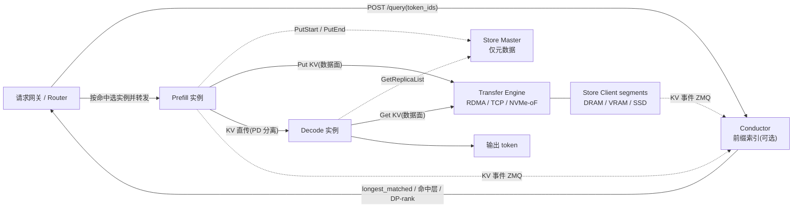
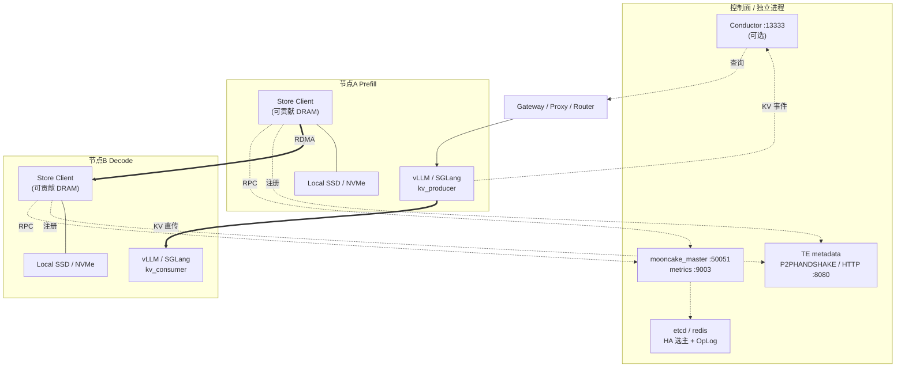

## 处理流程

于是端到端一次请求大致是：

1. 网关按前缀哈希向 Conductor 查询最佳实例；
2. 命中的 KV 直接复用，没命中的部分交给 Prefill 集群计算；
3. Prefill 算出的 KV 通过 Store Put 进全局缓存池（DRAM/VRAM/SSD）；
4. Decode 集群通过 TE Get 拉取 KV，继续自回归生

Prefill输出可能直接直传Decode，也可能先传Store，Decode再从Store拉取。

### 理解要点

- Conductor 不查缓存池，只单向消费 KV 事件（ZMQ PUB 的 `BlockStored` / `BlockRemoved`），在内存维护 `PrefixCacheTable`；router 通过 `POST /query` 拿到 `longest_matched`、命中层和 DP-rank 信息后再决定把请求转发给哪个实例。
- 命中与未命中都要先到 Prefill。命中只减少需要计算的 token 数，只有整段前缀全命中时才可能跳过 prefill 计算。
- Prefill → Decode 传的是 KV Cache 张量（GB 级），经 Transfer Engine 零拷贝直传，不是"消息"。
- 缓存池 = Store Master（仅元数据，不参与数据流）+ Client（各自贡献 segment 内存）+ Transfer Engine（数据面）。
- Conductor 是可选的路由辅助组件，核心 Mooncake 只有 Transfer Engine + Mooncake Store。

## 部署

Mooncake/docs/source/deployment/mooncake-store-deployment-guide.md
TE：TransferEngine（batchTransferSync）

| 组件               | 形态                                               | 是否必须     | 关键点                    |
| ---------------- | ------------------------------------------------ | -------- | ---------------------- |
| Transfer Engine  | 动态库 ，随 client/引擎进程加载                             | 必须       | 数据面，零拷贝 RDMA           |
| TE 元数据服务         | P2PHANDSHAKE （无进程）/ HTTP / etcd / Redis          | 必须（可无进程） | 发现 peer、rkey、网卡        |
| mooncake\_master | 独立进程                                             | 必须       | 只走控制面， 不在数据路径          |
| Store Client     | 嵌入 / mooncake\_store\_service / mooncake\_client | 必须       | 贡献 DRAM/VRAM/SSD 并收发数据 |
| 推理引擎 + Proxy     | vLLM / SGLang + 路由                               | 必须       | P/D 角色由 kv\_role 区分    |
| Conductor        | Go 独立进程                                          | 可选       | 前缀索引，供 router 查询       |
| SSD / DFS        | 本地盘或共享 FS                                        | 可选       | 扩容与持久化                 |

### Store Client

Store Client相当于是kvcache的存储后端，可以嵌入运行在vllm进程或者单独进程（如mooncake\_client），申请rdma使用的segment注册到master上
mooncake\_client 自己分配并注册一大块 DRAM 作为 segment 挂到 master，成为集群存储节点；它同时把 vLLM（dummy）通过 fd 传来的共享内存 mmap 进来并注册为 TE 的 本地 buffer （不是 segment），用于地址翻译和 RDMA 落点；它靠心跳与 master 保活自己的 segment，并监控 dummy 的生命周期负责清理。
mooncake\_store\_service 也是一个独立的Store Client进程，除了基本的提供内存能力外，还带一个aiohttp REST 服务（默认 :8080），可以被外部编排系统驱动。例如POST /api/mount\_shm可以通过共享内存让mooncake\_store\_service拿到外部vllm进程的kvcache内存并注册到集群。K8s / 编排托管、容量与进程解耦、共享内存挂载、PD 角色动态切换等场景用到。

## 推理引擎侧的三级缓存（SGLang HiCache）

Mooncake/docs/source/design/hicache-design.md
这才是对标 CPU L1/L2/L3 的那套（ hicache-design.md ）：

| 层级 | 介质             | 范围    | 访问方式        |
| -- | -------------- | ----- | ----------- |
| L1 | GPU VRAM       | 本实例私有 | 本地显存访问      |
| L2 | host DRAM      | 本实例私有 | PCIe / 共享内存 |
| L3 | Mooncake Store | 全集群共享 | RDMA 零拷贝远端读 |

「三级缓存」是推理引擎（HiCache）的概念：VRAM → 本机 DRAM → 集群共享 Store；而 Store 自己是「一个扁平内存池 + SSD/DFS 副本」，本地/远端只是访问路径差异

RDMA数据交换+ub共享存储？

